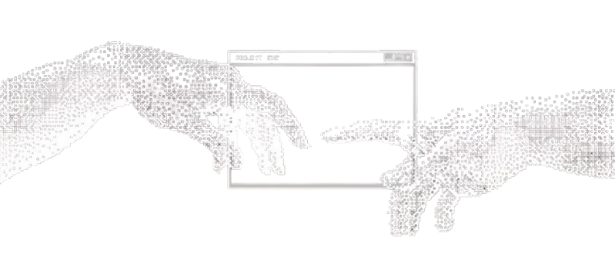

  

<h1 align="center">Hi 👋, I am Farhan Hibatullah</h1>

<h3 align="center">Full-Stack Engineer & 3D Creator @ RS Ananda</h3>

  

  Architecting resilient healthcare systems, local-first mobile intelligence, and immersive virtual environments.

<h2 align="center">🚀 About Me</h2>

I am **Farhan Hibatullah**, Full-Stack Engineer & 3D Creator at **RS Ananda Bekasi**.

My engineering work sits at the intersection of mission-critical system reliability and fluid, high-craft user interaction:

- 🏥 **Enterprise Healthcare Systems**: Engineering high-throughput hospital booking infrastructure, dynamic specialist registries with instant search filters, and automated kiosk barcode ticketing pipelines.
- 📱 **Mobile & Local-First AI**: Designing offline-first mobile apps powered by on-device SQLite state, scientific progression calculation engines, and adaptive multi-tier AI fitness coaching.
- 🎮 **3D Worlds & Simulation Systems**: Constructing interactive gameplay loops, procedural economy mechanics, and simulation environments in Roblox using Lua.

Clean architecture, zero-latency execution, and systems that hold under high concurrency.

 

<h2 align="center">🤝 Connect</h2>

  
  &nbsp;&nbsp;&nbsp;
  
  &nbsp;&nbsp;&nbsp;
  

<h2 align="center">💻 Tech Stack</h2>

  

  
  &nbsp;&nbsp;
  
  &nbsp;&nbsp;
  
  &nbsp;&nbsp;
  
  &nbsp;&nbsp;
  
  &nbsp;&nbsp;
  
  &nbsp;&nbsp;
  
  &nbsp;&nbsp;
  

<h2 align="center">📊 GitHub Stats</h2>

  

<h2 align="center">⌘ Commit Activity</h2>

<picture>
  <source media="(prefers-color-scheme: dark)" srcset="https://raw.githubusercontent.com/BangHann/BangHann/output/pacman-contribution-graph-dark.svg">
  <source media="(prefers-color-scheme: light)" srcset="https://raw.githubusercontent.com/BangHann/BangHann/output/pacman-contribution-graph.svg">
  

    
  

</picture>

<h2 align="center">⌘ Philosophy</h2>

  

<h2 align="center">🚀 Featured Projects</h2>

<table width="100%">
  <tr>
    <td width="50%" valign="top">
      <h3>🏥 RS Ananda Healthcare Portal</h3>
      
<b>Enterprise Hospital Booking & Clinical Registry</b>

      
High-availability hospital portal for RS Ananda Bekasi. Built dynamic specialist directories with instant AJAX filtering, 3-step booking flow with direct-doctor bypass, and automated kiosk barcode ticketing.

      
<code>Laravel 11</code> <code>Tailwind CSS v4</code> <code>Vite</code> <code>Alpine.js</code> <code>MySQL</code>

    </td>
    <td width="50%" valign="top">
      <h3>⚡ Gym Tracker & Nutrition AI Coach</h3>
      
<b>Offline-First Mobile Fitness Progression Engine</b>

      
Engineered for zero-latency logging in signal-free gym basements. Powered by on-device SQLite persistence, in-memory scientific 1RM calculations, and multi-tier AI progressive overload coaching.

      
<code>React Native</code> <code>Expo 52</code> <code>SQLite</code> <code>Express.js</code> <code>Zustand</code>

    </td>
  </tr>
  <tr>
    <td width="50%" valign="top">
      <h3>💰 Personal Finance Flow</h3>
      
<b>Real-Time Wealth Cockpit & Cashflow OS</b>

      
Interactive financial intelligence dashboard with real-time wealth trajectory charts, automated budget threshold alerts, and optimistic UI state transitions.

      
<code>React 19</code> <code>Express.js</code> <code>MySQL</code> <code>Recharts</code> <code>Zustand</code>

    </td>
    <td width="50%" valign="top">
      <h3>🎮 Roblox 3D Virtual Worlds (Fishing & Warung Sim)</h3>
      
<b>Immersive Simulation Systems & Algorithmic Loops</b>

      
End-to-end 3D gameplay loops built in Roblox Studio with Lua. Features modular client-server event architectures, weighted rarity drop tables, atmospheric water/audio design, and economic progression.

      
<code>Lua</code> <code>Roblox Studio</code> <code>Game Architecture</code> <code>Economy Loops</code>

    </td>
  </tr>
</table>

  Crafted with code, precision, and relentless iteration · <b>Farhan Hibatullah</b>

